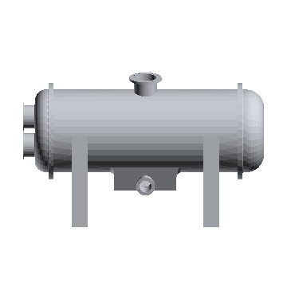
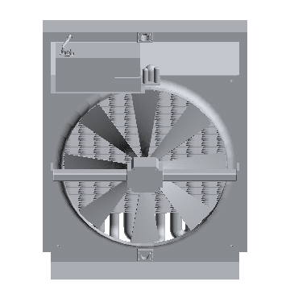
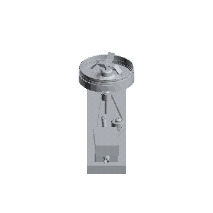
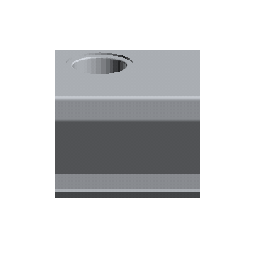

# Matthew Sabag

Mechanical engineering student at the University of Florida. I design and build hardware,
and I build the software and AI tools I need along the way.

**[matthewsabag.com](https://matthewsabag.com)** · engineering projects, interactive 3D models, resume

## Engineering

|  |  |
|:-:|:-:|
| **Steam condenser** Heat Transfer Design Challenge · GE Vernova brief | **Finned oil cooler** Heat Transfer Design Challenge · Sandvik brief |
|  |  |
| **Air engine + blender attachment** Design &amp; Manufacturing Lab · machined on mill and lathe | **3D-printed sliding shelf** Personal project · designed and printed for a dorm bed rail |

Click a model to open its project page.

## Projects

| Project | What it does | |
|---|---|---|
| **[matthewsabag.com](https://matthewsabag.com)** | My portfolio: engineering projects with interactive 3D models, built with Claude Code | [visit](https://matthewsabag.com) |
| **[free-delegate](https://github.com/mtthwsbg/free-delegate)** | Hands Claude's bulk work to free models: a delegation protocol for Claude Code and claude.ai | [repo](https://github.com/mtthwsbg/free-delegate) |
| **[media-download](https://github.com/mtthwsbg/media-download)** | A Chrome button that saves the video you're looking at as an MP4, sorted into folders (Windows) | [repo](https://github.com/mtthwsbg/media-download) |

Also building a few private tools for productivity and web design. If any of it sounds
useful to you, [reach out](https://matthewsabag.com/contact).

## Tools

SolidWorks · OnShape · AutoCAD · MATLAB · Python · C++ · Arduino · LabVIEW · JavaScript · Git
